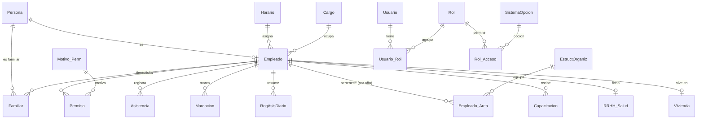

# Ingeniería inversa (Semana 3)

> Documento nuevo (noviembre 2026). La versión anterior apuntaba a `Scripts/bd-Normalizada/NORMALIZACION.md`, que no
> existe en este repositorio. Los datos de abajo salen de la base `RRHH_Normalizado` (catálogo de SQL Server:
> `sys.tables`, `sys.columns`, `sys.foreign_keys`) y de las dependencias de cada controller.

## 1. Reconocimiento funcional

| Aspecto | Hallazgo |
|---|---|
| Sistema de origen | Aplicación de escritorio VB.NET WinForms (.NET 2.0/3.5) con DevExpress y ClickOnce, sobre SQL Server LocalDB "CMI" |
| Propósito | Ficha integral del personal de un gobierno regional y control de su asistencia |
| Usuarios | Registradores de RR.HH. (uso diario) y administrador del sistema (usuarios, roles, catálogos). Hay 96 usuarios y 15 roles |
| Módulos | Personal, Salud, Familia, Asistencia (asistencia, marcaciones, registro diario, horarios temporales), Feriados, Capacitación, Permisos, Historial laboral, Comportamiento, Vivienda, Estructura orgánica, Mantenimiento (34 catálogos), Usuarios y roles, Bitácora |
| Procesos principales | Alta y edición de la ficha del empleado; registro de permisos; consulta y exportación de asistencia; ficha social (familia, salud, vivienda); administración de accesos |
| Hoy | ASP.NET Core MVC (.NET 10) en Azure Web App, con la BD en Azure SQL |

## 2. Base de datos

- **Motor:** SQL Server (Azure SQL en producción, SQL Server 2025 en local).
- **Tamaño:**
  - 88 tablas, todas con clave primaria;
  - 84 claves foráneas;
  - 6 vistas: `vw_Ubigeo`, `vw_EmpleadoAreaActual`, `vw_EmpleadoResumenFamiliar`, `vw_FamiliarDetalle`, `vw_EstructOrganizDotacion` y `vw_RRHH_FuncFam`.

**Tablas más grandes** (filas):

| Tabla | Filas | Tabla | Filas |
|---|---:|---|---:|
| RegAsisDiario | 263 520 | Persona | 4 106 |
| Marcacion | 200 184 | Empleado | 3 335 |
| Asistencia | 153 964 | Incidencia | 2 202 |
| Empleado_Area | 35 884 | Capacitacion | 2 177 |
| Permiso | 26 120 | EstructOrganiz | 1 433 |
| HorarioTemporal | 11 353 | Familiar | 966 |

### Modelo entidad-relación inferido (entidades clave)

### Diccionario de datos (tablas clave)

| Tabla | Clave primaria | Columnas relevantes | Relaciones |
|---|---|---|---|
| **Persona** | `IdPersona` | `Nombres` (100, obligatorio), `Apellido_Paterno`/`Materno` (30), `TipoDocID`, `NumDocID` (12), `Sexo`, `FechaNacimiento`, `Direccion` (100), `IdUbigeo` (6), `Email` (50), `Foto` (varbinary) | TipoDocID, EstadoCivil, Nacionalidad, TipoSangre, Discapacidad, Distrito |
| **Empleado** | `IdEmpleado` | `IdPersona` (obligatorio), `FechaIngreso`, `Estado` (bit), `IdCargo`, `idHorario`, `idLocal`, `IdAFP`, `NroAFP` (20), `CargaFam` | Persona, Cargo, Horario, Local, TipoTrabajador, RegimenPension, AFP, ViveCon |
| **Permiso** | `IdEmpleado` + `NPermiso` | `idMotivo`, `FechaInicio`/`FechaFin`, `Hora_Sal`/`Hora_Ret`, `Dia`, `Autorizado`, `Referencia` (100), `Obs` (200) | Empleado, Motivo_Perm |
| **Asistencia** | `Fecha` + `IdEmpleado` | `Hor_Ent`, `Alm_Sal`, `Alm_Ent`, `Hor_Sal` (time), `Estado`, `Usuario`, `PC` | Empleado, Horario |
| **Marcacion** | `Fecha` (datetime) + `IdEmpleado` | `NroMarcacion`, `TipoMarcacion` (1), `CodDispositivo` (10), `idHorario` | Empleado, TipoMarcacion, DispositivoMarcacion, Horario |
| **EstructOrganiz** | `Year` + `idAreaOrganiz` | `AreaOrganizacional` (200), `Abrev` (10), `Sigla` (6), `idDependeDe` (jerarquía), `IdEmpleado` (responsable) | Se versiona por año |
| **Empleado_Area** | `Year` + `idAreaOrganiz` + `IdEmpleado` | — | Empleado, EstructOrganiz. Área actual en `vw_EmpleadoAreaActual` |
| **Usuario** | `IdUsuario` | `Login` (20), `Descripcion` (40), `PasswordHash` (200), `Estado`, `IdEmpleado` | Usuario_Rol |
| **Rol** | `IdRol` | `Descripcion` (30), `IdSistema` (7: a qué sistema del gobierno regional pertenece) | Usuario_Rol, Rol_Acceso |
| **Rol_Acceso** | `IdRol` + `IdSistemaOpcion` | — | Rol, SistemaOpcion |
| **SistemaOpcion** | `IdSistemaOpcion` (char 7) | `Descripcion` (150). Códigos jerárquicos: `0500000` RRHH y `0502001`–`0502012` sus módulos | Rol_Acceso |

## 3. Matriz módulos ↔ tablas

Obtenida de las clases `*Logica` que recibe cada controller y sus servicios:

| Módulo (controller) | Tablas que usa |
|---|---|
| Personal (`Empleado` + `Services/Empleado*`) | Empleado, Persona, Cargo, Horario, Local, EstructOrganiz, Empleado_Area, TipoTrabajador, RegimenPension, AFP, EstadoCivil, TipoSangre, Discapacidad, ViveCon, Nacionalidad, TipoDocID, Ubigeo, Resolucion, TipoResolucion, RRHH_AspSocio; vistas `vw_EmpleadoAreaActual` y `vw_EmpleadoResumenFamiliar` |
| Asistencia | Asistencia, Marcacion, RegAsisDiario, HorarioTemporal, Horario, TipoMarcacion, DispositivoMarcacion, EstadoAsistencia, Empleado, Persona |
| Permisos | Permiso, Motivo_Perm, Empleado, Persona |
| Capacitación | Capacitacion, EstudiosRealizado, TitulosEmpleado, TipoEstudio, EstadoEstudio, Empleado, Persona |
| Familia / Ficha social (`Familia`, `FamiliaSalud`) | Familiar, Persona, TipoFamiliar, RRHH_TipoFamilia, RRHH_RelacPareja, RRHH_RelacPH, RRHH_RelacHermano, RRHH_DinamicaFamiliar, RRHH_FuncFam, RRHH_AspSocio, RRHH_Salud, RRHH_Asegurado, RRHH_AcudeEnferm, VinculoAsegurado, EstadoCivil, Discapacidad, TipoSangre; vista `vw_FamiliarDetalle` |
| Salud | RRHH_Salud, RRHH_Asegurado, RRHH_AcudeEnferm, VinculoAsegurado, MotivoBaja, EstadoCivil, Empleado, Persona |
| Historial laboral | PeriodoLaboral, ExpLaboral, Rotacion, Resolucion, TipoResolucion, TipoInstitucion, EstructOrganiz, Empleado, Persona |
| Vivienda | Vivienda, ViviendaServicio, ServicioViv, TipoViv, TenenciaViv, UbicacionViv, AguaViv, AlumbradoViv, ConservacionViv, ExcretasViv, MaterialViv, Empleado, Persona |
| Estructura orgánica | EstructOrganiz, Empleado_Area, ResponsableXUO, Local, Empleado, Persona; vista `vw_EstructOrganizDotacion` |
| Comportamiento | Comportamiento, TipoComportamiento, Empleado, Persona |
| Feriados | RRHH_Feriado |
| Inicio (dashboard) | Empleado, Persona, Asistencia, EstructOrganiz, Cargo, RRHH_Feriado, `vw_EmpleadoAreaActual` |
| Mantenimiento (`Catalogo`) | Los 34 catálogos editables de `CatalogoRepositorio`, Bitacora |
| Seguridad (`Seguridad`, `SeguridadAdmin`) | Usuario, Usuario_Rol, Rol, Rol_Acceso, SistemaOpcion, Bitacora, Empleado, Persona |

## 4. Hallazgos

| Hallazgo | Consecuencia | Qué se hizo |
|---|---|---|
| Tablas de 150 000 a 263 000 filas (Asistencia, Marcacion, RegAsisDiario) que el sistema cargaba completas | Páginas de más de 30 s o con error de tiempo de espera | Filtro y paginación en la BD (SC-003, SC-005) |
| Columnas que la BD permite nulas pero el formulario exige | EF las leía como NOT NULL y fallaba con datos antiguos | `EvoRRLDbContext` respeta la nulabilidad real (SC-008) |
| Datos heredados que no cumplen las reglas de negocio: 40 pares de permisos solapados, 41 capacitaciones y 11 estudios con fechas invertidas, 5 RUC mal formados (base local) | Al editarlos hay que corregirlos | `Scripts/sc-008-auditoria-datos.sql` (solo lectura) los mide |
| `Rol` es compartido por varios sistemas del gobierno regional (`IdSistema`: PTI, SIA, Caja, Trámite, RRHH, Consejo Regional, SIAB) y hay 4 roles llamados "ADMINISTRADOR" | Administradores de otros sistemas tenían acceso total a RRHH | Solo es administrador el de RRHH (`0500000`) (SC-009, `v1.6.0`) |
| `Rol_Acceso` vacía y `SistemaOpcion` sin opciones por módulo | Los permisos por opción no se podían aplicar | Se siembran 12 opciones `0502001`–`0502012` y se aplican al menú y a cada módulo |
| Nombres de columnas inconsistentes (`idHorario` frente a `IdCargo`, `Hor_Ent`, `DecLey`) | Hay que leer el esquema para entender cada campo | Se respetan en las entidades; documentado aquí |
| `EstructOrganiz` se versiona por año (`Year` + `idAreaOrganiz`) y el área actual sale de una vista | Una consulta ingenua mezcla áreas de años distintos | Se usa `vw_EmpleadoAreaActual` |
| 14 tablas sin relaciones declaradas | Integridad solo por convención | Pendiente de revisar tabla por tabla |
| Todos los DNI cumplen el formato de 8 dígitos y todas las personas tienen empleado o familiar | Datos de identidad consistentes | Se mantiene con `[Dni]` y `ReglasPersona` |
